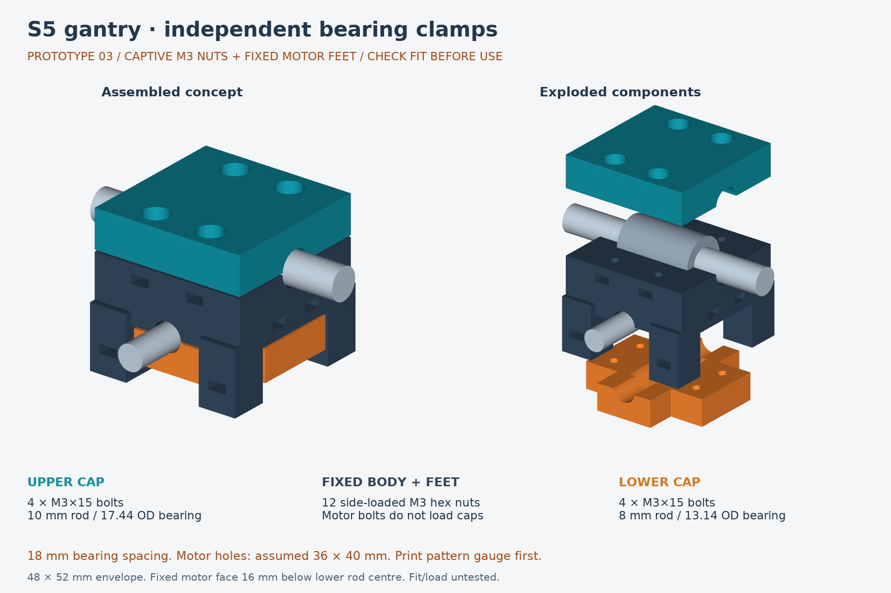

# S5 gantry — independent bearing clamp

## Current design: captive-nut prototype v3

[Design, dimensions, assumptions and assembly instructions](independent_clamp_nut_v3/README.md) · [Detailed Bunnings shopping list](independent_clamp_nut_v3/SHOPPING_LIST.md)

The current prototype has independent upper/lower bearing caps, twelve side-loaded M3 hex-nut pockets, and fixed motor-mount feet. It uses the user's 18 mm middle-core measurement. Motor attachment does not clamp the bearing caps together.

**Prototype only: physical fit and drill-load strength are untested.** The motor-hole pattern is assumed to be 36 × 40 mm, not a verified original S5 dimension. The new motor mounting face is 16 mm below the lower rod centre, so tool height and travel limits must be checked again. M3×20 motor bolts assume an accessible mounting flange 2–10 mm thick, nominally 4 mm.

Print the [nut-fit coupon](independent_clamp_nut_v3/generated/M3_nut_fit_CHECK_FIRST.stl) and [mounting-pattern gauge](independent_clamp_nut_v3/generated/motor_pattern_CHECK_FIRST.stl) before the large parts. Check the actual bearings with the included bearing-fit coupons too.

## Shopping summary

Online listings checked 22 October 2026; Campbelltown stock is **not confirmed**. Prices may change.

| Buy | Bunnings product | Item number | Listed price |
|---|---|---|---:|
| 1 pack | [M3×15 mm zinc-plated round-head bolts and nuts, 20-pack](https://www.bunnings.com.au/pinnacle-m3-x-15mm-zinc-plated-round-head-bolts-and-nuts-20-pack_p0168388) | 0168388 | $4.12 |
| 1 pack | [M3×20 mm zinc-plated round-head bolts and nuts, 18-pack](https://www.bunnings.com.au/pinnacle-m3-x-20mm-zinc-plated-round-head-bolts-and-nuts-18-pack_p0247264) | 0247264 | $1.86 |
| 2 packs | [M3 flat washers, 12-pack](https://www.bunnings.com.au/pinnacle-m3-black-flat-washer-12-pack_p0257725) | 0257725 | $3.06 total |

Listed total: **$9.04**. Required hardware is eight M3×15 bolts, four M3×20 bolts, twelve plain M3 hex nuts and twelve washers; packs provide spares. Nuts are included, so no separate nut pack or heat-set inserts are needed. Do not substitute nyloc, flange or countersunk hardware.

Nominal nuts: 5.5 mm across flats × 2.4 mm thick. Washer OD: 7 mm; design stack assumes 0.5 mm thickness (checked clamp range 0.3–0.8 mm). Check purchased hardware using the coupon before the full print.

Useful extras if not already owned: a caliper, screwdriver matching the purchased heads, tweezers, a fine file/deburring tool and a 3.5 mm drill bit for clearance-hole cleanup. Only modify existing plastic holes after confirming pattern alignment and adequate wall thickness. Do not drill installed hardware or assume threaded metal holes can be enlarged.

[Bunnings Campbelltown](https://www.bunnings.com.au/stores/nsw/campbelltown): corner Blaxland Road and Farrow Road; **02 4634 6400**. Check stock before travelling. No reservation/order has been placed.

## CAD and print files

- [Assembled STEP](independent_clamp_nut_v3/generated/housing_assembly_DRAFT.step)
- [Centre body STL](independent_clamp_nut_v3/generated/centre_body_DRAFT.stl)
- [Upper cap STL](independent_clamp_nut_v3/generated/upper_X_cap_DRAFT.stl)
- [Lower cap STL](independent_clamp_nut_v3/generated/lower_Y_cap_DRAFT.stl)
- [Parametric source](independent_clamp_nut_v3/build_model.py) and [parameters](independent_clamp_nut_v3/parameters.json)
- [Geometry validation report](independent_clamp_nut_v3/generated/validation.json)

All eleven v3 STL meshes passed closed-edge, positive-volume and grounding checks. The CAD checks cover solid validity, STEP round-trip volumes, idealized hardware interference, bolt engagement and lower-cap closure clearance. They are not physical fit or structural tests.

## Earlier versions

`independent_clamp_draft_v1` and `independent_clamp_18mm_v2` are retained as design history, not current print recommendations. Do not mix their parts with v3. Original source media and the saved Teams chat remain local and are not part of this CAD publication.
