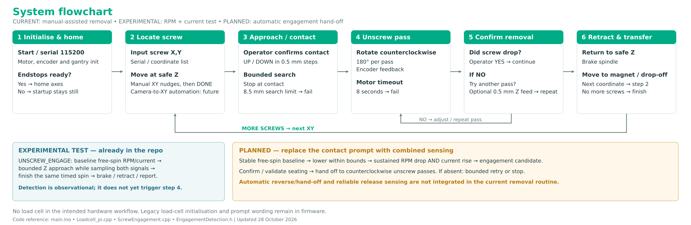
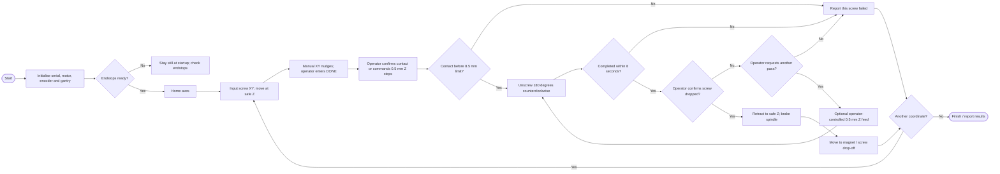
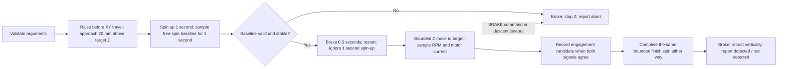
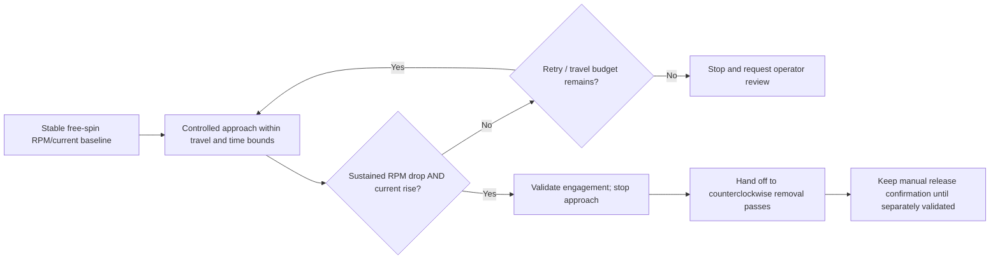

# System flowchart

Updated 28 October 2026 from `System Integration/main/` at commit `3b2d02b` and the team's intended RPM/current engagement plan. The physical setup no longer uses the load cell. This is a documentation update; it does not change the firmware.

[PNG for Canva](images/system_flowchart.png) · [SVG](images/system_flowchart.svg)

## Current removal cycle

`UNSCREW X Y` calls `runScrewRemovalFlow`. `UNSCREWCHAIN` runs it for a coordinate list. The `LoadcellPi_*` names are legacy names: these functions currently ask the operator through Serial; they are not automatic sensor decisions.

The chain currently continues after a failed screw. The failure returns do **not** all perform the success-path retraction and drop-off; do not interpret the diagram as a complete automatic recovery system. Startup's endstop check is not a general motion interlock.

The code's safe Z is 80 mm and drop-off coordinates are `(225, 330)` via approach Y = 280 mm. These are firmware configuration values, not verified dimensions of the illustration model.

## Experimental engagement test already in code

`UNSCREW_ENGAGE X Y Z [signed_speed] [finish_ms]` is separate from `UNSCREW`; it does not automatically begin the removal cycle or reverse direction when engagement is detected.

Current detector settings in `EngagementDetection.h`:

- Compare absolute RPM with a stable free-spin baseline.
- Candidate RPM drop: at least 2.5%, on two checks spaced at least 100 ms apart.
- Candidate current increase: at least 0.08 A above baseline, using a five-sample moving average.
- Require the current rise within a 200 ms coincidence window of RPM confirmation.

These are experimental tuning values, **not proof that the bit is seated** and not calibrated limits for every drill/HDD. The test records detection but finishes the same Z/spin sequence whether detection occurs or not.

## Planned integration

The planned change replaces the manual contact/engagement prompt with combined RPM/current feedback. Automatic hand-off/reversal, retry handling and reliable release sensing still need integration and validation. Camera-to-gantry coordinate generation is also future work; the current removal entry point receives XY over Serial.

Legacy `Loadcell_Init()`, `LOAD` support and load-cell wording remain in the source. They are omitted from the intended physical workflow because the team has removed the load cell. No force threshold or tare step belongs in the new hardware diagram.

Sources: [main.ino](../System%20Integration/main/main.ino), [Loadcell_pi.cpp](../System%20Integration/main/Loadcell_pi.cpp), [ScrewEngagement.cpp](../System%20Integration/main/ScrewEngagement.cpp), [EngagementDetection.h](../System%20Integration/main/EngagementDetection.h).
